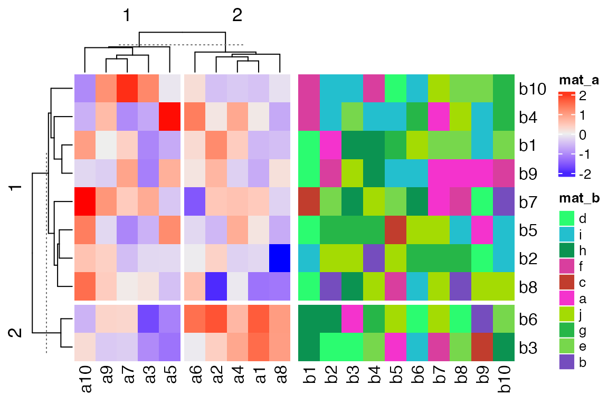
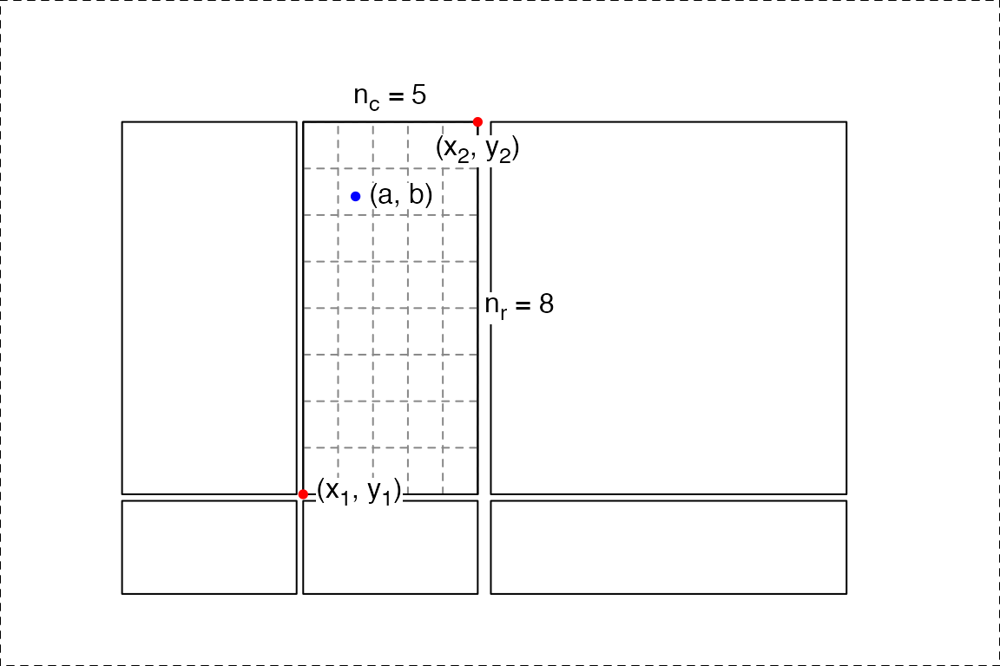

# How interactive complex heatmap is implemented

    ## Warning: package 'knitr' was built under R version 4.6.1

Heatmaps are mainly for visualizing common patterns that are shared by
groups of rows and columns. After the patterns are observed, the next
step is to extract the corresponding groups of rows and columns from the
heatmap, which requires interactivity on the heatmaps. The
**ComplexHeatmap** package is well known for generating **static
heatmaps** (a single heatmap or a list of heatmaps, possibly with
complex annotations). Here the package **InteractiveComplexHeatmap**
brings interactivity to **ComplexHeatmap**. The new functionalities
allow users to capture sub-heatmaps by clicking/hovering single cells or
selecting areas from heatmaps.

Unlike other packages which support interactive heatmaps based on
JavaScript, *e.g.*, **iheatmapr**, **heatmaply** and **d3heatmap**, the
package **InteractiveComplexHeatmap** has a special way to capture the
positions that users selected and to extract the corresponding values
from the matrices. In this vignette, I will explain in details how the
interactivity is implemented based on **ComplexHeatmap**.

To demonstrate it, I first generate a list of two heatmaps and apply
*k*-means clustering on the numeric heatmap.

``` r

library(ComplexHeatmap)
library(InteractiveComplexHeatmap)
set.seed(123)
mat1 = matrix(rnorm(100), 10)
rownames(mat1) = colnames(mat1) = paste0("a", 1:10)
mat2 = matrix(sample(letters[1:10], 100, replace = TRUE), 10)
rownames(mat2) = colnames(mat2) = paste0("b", 1:10)

ht_list = Heatmap(mat1, name = "mat_a", row_km = 2, column_km = 2) +
    Heatmap(mat2, name = "mat_b")
```

**InteractiveComplexHeatmap** implements two types of interactivity:

1.  on the interactive graphics device,
2.  on a Shiny app.

The interactivity on the interactive graphics device is the basis of the
interactivity of the Shiny app, so in the following sections, I will
first introduce how the interactivity is implemneted with the
interactive graphics device.

## On the interactive graphics device

Here the “interactive graphics device” is the window that is opened for
generating plots in your R session if you use R in the terminal or in a
native R GUI, or the figure panel in Rstudio IDE.

I will first explain how **InteractiveComplexHeatmap** captures the
positions that user clicked on the device and how it is associated to
the values in the matrix.

When user clicks on the device, the physical locations relative in the
device (offsets to the bottom left of the device on both x and y
directions) are captured by
[`grid::grid.locator()`](https://rdrr.io/r/grid/grid.locator.html). The
physical locations of the heatmaps (more precisely, the heatmap slices)
can also be captured by
[`grid::deviceLoc()`](https://rdrr.io/r/grid/deviceLoc.html). With
knowing the exact positions of the clicked points and the heatmaps, it
is possible to tell which heatmap the clicked points are in.
Furthermore, by calculating the relative distance of the clicked points
in that heatmap, it is also possible to know which rows and columns the
clicked points correspond to.

For associating user’s clicked points and the heatmaps, we first need to
calculate the positions of all heatmaps. There is a helper function
[`htPositionsOnDevice()`](../reference/htPositionsOnDevice.md) that does
this job.

Before executing
[`htPositionsOnDevice()`](../reference/htPositionsOnDevice.md), the
heatmap should be drawn on the device and the layout of heatmaps should
have been generated so that
[`htPositionsOnDevice()`](../reference/htPositionsOnDevice.md) can
access various viewports of the plot. Thus, the heatmap object `ht_list`
should be updated explicitly by the
[`draw()`](https://rdrr.io/pkg/ComplexHeatmap/man/draw-dispatch.html)
function.

The following code draws the heatmap in a device with 6 inches width and
4 inches height.

``` r

ht_list = draw(ht_list)
pos = htPositionsOnDevice(ht_list)
```



The returned object `pos` is a `DataFrame` object that contains the
positions of all heatmap slices. A `DataFrame` object (the `DataFrame`
class is defined in [**S4Vectors**
package](https://bioconductor.org/packages/release/bioc/html/S4Vectors.html))
is bacially very similar to a data frame, but it can store more complex
data types, such as the `simpleUnit` vectors (generated by
[`grid::unit()`](https://rdrr.io/r/grid/unit.html)).

``` r

pos
```

    ## DataFrame with 6 rows and 8 columns
    ##       heatmap                  slice row_slice column_slice
    ##   <character>            <character> <integer>    <integer>
    ## 1       mat_a mat_a_heatmap_body_1_1         1            1
    ## 2       mat_a mat_a_heatmap_body_1_2         1            2
    ## 3       mat_a mat_a_heatmap_body_2_1         2            1
    ## 4       mat_a mat_a_heatmap_body_2_2         2            2
    ## 5       mat_b mat_b_heatmap_body_1_1         1            1
    ## 6       mat_b mat_b_heatmap_body_2_1         2            1
    ##                    x_min                  x_max                  y_min
    ##             <simpleUnit>           <simpleUnit>           <simpleUnit>
    ## 1 0.732318701591533inc.. 1.77971604907863inches  1.0313072492669inches
    ## 2 1.81908612781879inches 2.86648347530589inches  1.0313072492669inches
    ## 3 0.732318701591533inc.. 1.77971604907863inches 0.432843658241349inc..
    ## 4 1.81908612781879inches 2.86648347530589inches 0.432843658241349inc..
    ## 5  2.9452236327862inches 5.07938840650056inches  1.0313072492669inches
    ## 6  2.9452236327862inches 5.07938840650056inches 0.432843658241349inc..
    ##                    y_max
    ##             <simpleUnit>
    ## 1 3.26768129840847inches
    ## 2 3.26768129840847inches
    ## 3 0.991937170526741inc..
    ## 4 0.991937170526741inc..
    ## 5 3.26768129840847inches
    ## 6 0.991937170526741inc..

We can confirm whether the positions are correctly captured by the
following code. In the next figure, black rectangles correspond to the
heatmap slices and the dashed rectangle corresponds to the border of the
whole image.


``` r

dev.new(width = 6, height = 4)
grid.newpage()
grid.rect(gp = gpar(lty = 2))
for(i in seq_len(nrow(pos))) {
    x_min = pos[i, "x_min"]
    x_max = pos[i, "x_max"]
    y_min = pos[i, "y_min"]
    y_max = pos[i, "y_max"]
    pushViewport(viewport(x = x_min, y = y_min, name = pos[i, "slice"],
        width = x_max - x_min, height = y_max - y_min,
        just = c("left", "bottom")))
    grid.rect()
    upViewport()
}
```

Yes, the positions of all heatmap slices are correctly captured!

Since now we know the location of the clicked points (by
[`grid::grid.locator()`](https://rdrr.io/r/grid/grid.locator.html)) and
the positions of all heatmap slices, it is possible to calculate which
row and which column in the original matrix user’s click corresponds to.

In the next figure, the blue point with the coordinate $`(a, b)`$ is
clicked by user. The heatmap slice where user clicked into has range
$`(x_1,x_2)`$ on x direction and range $`(y_1, y_2)`$ on y direction and
this heatmap slice can be easily found by comparing the locations of
every heatmap slice to the position of the click. There are $`n_r`$ rows
($`n_r
=8`$) and $`n_c`$ columns ($`n_c = 5`$) in this heatmap slice and they
are marked by dashed lines. Note all the coordinate values (*i.e.*,
$`a`$, $`b`$, $`x_1`$, $`y_1`$, $`x_2`$ and $`y_2`$) are measured as the
physical positions in the graphics device.



In this heatmap slice, the row index $`i_r`$ and column index $`i_c`$ of
the cell where the point is in can be calculated as (assume the left
bottom corresponds to the index of 1 for both rows and columns):

``` math
 i_c = \lceil \frac{a - x_1}{x_2 - x_1} \cdot n_c \rceil 
```
``` math
 i_r = \lceil \frac{b - y_1}{y_2 - y_1} \cdot n_r \rceil 
```

where the symbol $`\lceil x \rceil`$ means the ceiling of the numeric
value $`x`$. In **ComplexHeatmap**, the row with index 1 is always put
on the top of the heatmap, then $`i_r`$ should be adjusted as:

``` math
 i_r = n_r - \lceil \frac{b - y_1}{y_2 - y_1} \cdot n_r \rceil + 1 
```

The subset of row and column indices of the original matrix that belongs
to the selected heatmap slice is already stored in `ht_list` object
(they can be retrieved by
[`row_order()`](https://rdrr.io/pkg/ComplexHeatmap/man/row_order-dispatch.html)
and
[`column_order()`](https://rdrr.io/pkg/ComplexHeatmap/man/column_order-dispatch.html)
function), thus, we can obtain the row and column index of the original
matrix that corresponds to user’s point easily with $`i_r`$ and $`i_c`$.

Denote the matrix for the complete heatmap (without slicing) as $`M`$,
and denote the subset of row and column indices in that heatmap as
$`o^{\mathrm{row}}`$ and $`o^{\mathrm{col}}`$. Note,
$`o^{\mathrm{row}}`$ and $`o^{\mathrm{col}}`$ can be reordered due to
clustering. Then the row and column indices ($`j_r`$ and $`j_c`$) for
the selected point in $`M`$ are

``` math
j_r = o^{\mathrm{row}}_{i_r}
```
``` math
j_c = o^{\mathrm{col}}_{i_c}
```

And the corresponding value in $`M`$ is $`M_{j_r, j_c}`$.

**InteractiveComplexHeatmap** has two functions
[`selectPosition()`](../reference/selectPosition.md) and
[`selectArea()`](../reference/selectArea.md) which allow users to pick
single positions or select areas from the heatmaps. Under the
interactive graphics device, users do not need to run
[`htPositionsOnDevice()`](../reference/htPositionsOnDevice.md)
explicitly. The positions of heatmaps are automatically calculated,
cached and reused if the heatmaps are the same and the device has not
changed its size. If users changed the device size,
[`htPositionsOnDevice()`](../reference/htPositionsOnDevice.md) will be
automatically re-executed.

The next image shows an example of using
[`selectPosition()`](../reference/selectPosition.md).

Interactively, the function asks user to click one position on the
heatmap. The function returns a `DataFrame` which contains the heatmap
name, slice name and the row/column index of the matrix in that heatmap.

    ## DataFrame with 1 row and 6 columns
    ##       heatmap                  slice row_slice column_slice row_index
    ##   <character>            <character> <numeric>    <numeric> <integer>
    ## 1       mat_a mat_a_heatmap_body_1_2         1            2         9
    ##   column_index
    ##      <integer>
    ## 1            1

The output means, the position user clicked is in a heatmap called
“mat_a”, in its first row slice and the second column slice. Assume
`mat` is the matrix sent to heatmap “mat_a”, then the clicked point
correspond to the value `mat[9, 1]`.

If the position clicked is not in any of the heatmap slices, the
function returns `NULL`.

Similarly, the [`selectArea()`](../reference/selectArea.md) function
asks user to click two positions on the heatmap which defines an area.

Note since the selected area may overlap over multiple heatmaps and
slices, the function returns a `DataFrame` with multiple rows which
contains the heatmap names, slice names and the row/column indices in
that heatmap. An example output is as follows.

    ## DataFrame with 4 rows and 6 columns
    ##       heatmap                  slice row_slice column_slice     row_index
    ##   <character>            <character> <numeric>    <numeric> <IntegerList>
    ## 1       mat_a mat_a_heatmap_body_1_2         1            2     7,5,2,...
    ## 2       mat_a mat_a_heatmap_body_2_2         2            2           6,3
    ## 3       mat_b mat_b_heatmap_body_1_1         1            1     7,5,2,...
    ## 4       mat_b mat_b_heatmap_body_2_1         2            1           6,3
    ##    column_index
    ##   <IntegerList>
    ## 1     2,4,1,...
    ## 2     2,4,1,...
    ## 3     1,2,3,...
    ## 4     1,2,3,...

The columns `row_index` and `column_index` are stored in `IntegerList`
format. To get the row indices in *e.g.* `mat_a_heatmap_body_1_2` (in
the first row), user can use either one of the following command (assume
the `DataFrame` object is called `df`):

``` r

df[1, "row_index"][[1]]
unlist(df[1, "row_index"])
df$row_index[[1]]
```

The rectangle and the points that mark the area can be turned off by
setting `mark` argument to `FALSE`.

## On off-screen graphics devices

It is also possible to use
[`selectPosition()`](../reference/selectPosition.md) and
[`selectArea()`](../reference/selectArea.md) on other off-screen
graphics devices, such as
[`pdf()`](https://rdrr.io/r/grDevices/pdf.html) or
[`png()`](https://rdrr.io/r/grDevices/png.html). Now you cannot select
the positions interactively, but instead you can specify `pos` argument
in [`selectPosition()`](../reference/selectPosition.md) and
`pos1`/`pos2` in [`selectArea()`](../reference/selectArea.md) to
simulate clicks. The values for `pos`, `pos1` and `pos2` all should be a
`unit` object of length two which correspond to the x and y coordinate
of the positions.

``` r

pdf(...)
ht_list = draw(ht_list)
pos = selectPosition(ht_list, pos = unit(c(3, 3), "cm"))
dev.off()
```


    ##   Point: x = 3.0 cm, y = 3.0 cm (measured in the graphics device)
    ## 
    ## The heatmaps have been changed. Calculate new heatmap positions.
    ## Search in heatmap 'mat_a'
    ##   - row slice 1, column slice 1 [mat_a_heatmap_body_1_1]... overlap

``` r

pos
```

    ## DataFrame with 1 row and 8 columns
    ##       heatmap                  slice row_slice column_slice row_index
    ##   <character>            <character> <numeric>    <numeric> <integer>
    ## 1       mat_a mat_a_heatmap_body_1_1         1            1         8
    ##   column_index   row_label column_label
    ##      <integer> <character>  <character>
    ## 1            7          a8           a7

``` r

pdf(...)
ht_list = draw(ht_list)
pos = selectArea(ht_list, pos1 = unit(c(3, 3), "cm"), pos2 = unit(c(5, 5), "cm"))
dev.off()
```


    ##   Point 1: x = 3.0 cm, y = 3.0 cm (measured in the graphics device)
    ##   Point 2: x = 5.0 cm, y = 5.0 cm (measured in the graphics device)
    ## 
    ## Heatmap positions are already calculated, use the cached one.
    ## Search in heatmap 'mat_a'
    ##   - row slice 1, column slice 1 [mat_a_heatmap_body_1_1]... overlap
    ## Search in heatmap 'mat_a'
    ##   - row slice 1, column slice 2 [mat_a_heatmap_body_1_2]... overlap
    ## Search in heatmap 'mat_a'
    ##   - row slice 2, column slice 1 [mat_a_heatmap_body_2_1]... no overlap
    ## Search in heatmap 'mat_a'
    ##   - row slice 2, column slice 2 [mat_a_heatmap_body_2_2]... no overlap
    ## Search in heatmap 'mat_b'
    ##   - row slice 1, column slice 1 [mat_b_heatmap_body_1_1]... no overlap
    ## Search in heatmap 'mat_b'
    ##   - row slice 2, column slice 1 [mat_b_heatmap_body_2_1]... no overlap

``` r

pos
```

    ## DataFrame with 2 rows and 8 columns
    ##       heatmap                  slice row_slice column_slice     row_index
    ##   <character>            <character> <numeric>    <numeric> <IntegerList>
    ## 1       mat_a mat_a_heatmap_body_1_1         1            1     7,5,2,...
    ## 2       mat_a mat_a_heatmap_body_1_2         1            2     7,5,2,...
    ##    column_index       row_label    column_label
    ##   <IntegerList> <CharacterList> <CharacterList>
    ## 1         7,3,5    a7,a5,a2,...        a7,a3,a5
    ## 2             6    a7,a5,a2,...              a6

Users do not need to use this functionality directly with an off-screen
graphics device, however, it is very useful when developing a Shiny app
where the plot is actually generated under an off-screen graphics
device. I will explain it in the next section.

## Shiny app

With the three functions
[`htPositionsOnDevice()`](../reference/htPositionsOnDevice.md),
[`selectPosition()`](../reference/selectPosition.md) and
[`selectArea()`](../reference/selectArea.md), it is possible to
implement Shiny apps for interactively working with heatmaps. Now the
problem is how does the server side capture the positions that user
clicked on the web page. Luckily, there is a solution for this. The
output heatmap is normally put within a
[`shiny::plotOutput()`](https://rdrr.io/pkg/shiny/man/plotOutput.html)
and [`plotOutput()`](https://rdrr.io/pkg/shiny/man/plotOutput.html)
provides two actions `click` and `brush`. Then on the server side, it is
possible to get the information of the positions that user clicked. The
positions can then be set to
[`selectPosition()`](../reference/selectPosition.md) and
[`selectArea()`](../reference/selectArea.md) via `pos` or `pos1`/`pos2`
arguments to correctly correspond to the values in original matrices.

\
\
\
\
\
\
\
\
